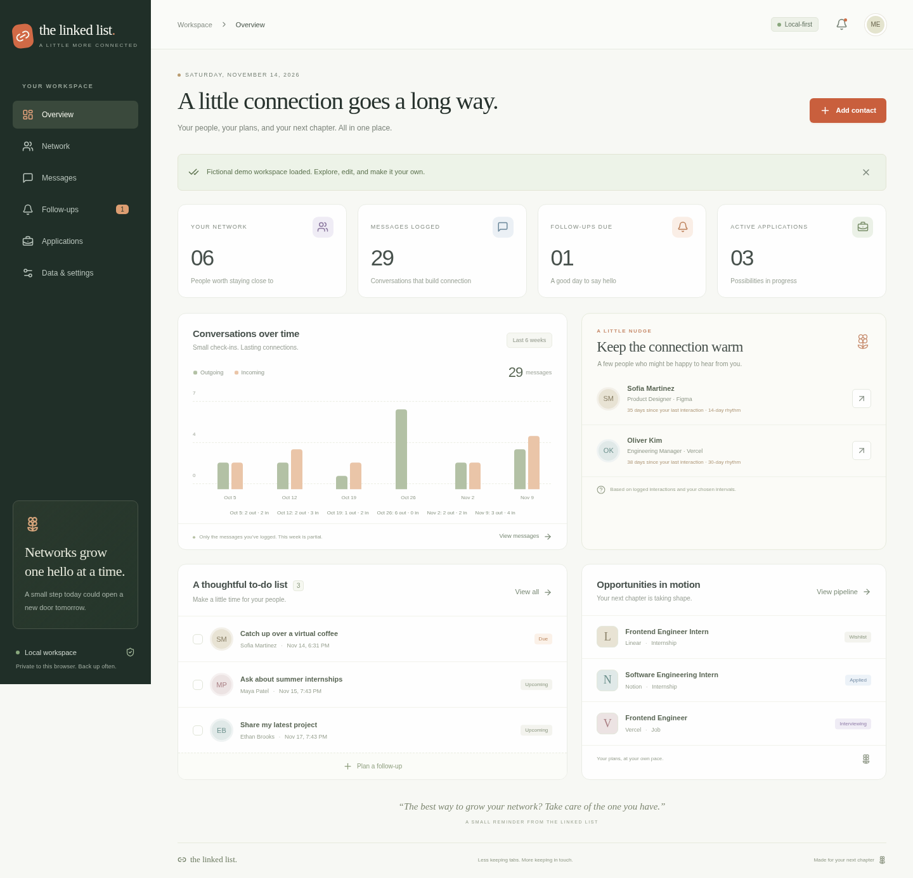

# The Linked List

### Small gestures. Stronger connections.

A local-first personal CRM for your professional network and early career job search. Built with TypeScript and React. No sign-in, API keys, subscription, scraping, or automated LinkedIn messaging.



## Run tonight

Install **Node.js 24 LTS** and npm. Extract this entire project, open a terminal in it, then:

```sh
npm ci
npm run dev
```

Open the localhost address printed in the terminal (normally http://localhost:5173). Keep the same hostname and port to see the same browser data. Stop with Ctrl+C. No .env file is needed.

Start empty or choose **Load demo workspace** to explore fictional contacts, messages, follow-ups, and applications. Go to Data & settings to import the included `public/example-connections.csv`. Export a JSON backup before clearing browser data or moving machines. A browser database is not a backup.

## Working features

- Searchable contacts with editable profiles, notes, tags, LinkedIn links, and personal follow-up intervals.
- LinkedIn-style Connections.csv import: quoted CSV, preamble handling, preview, duplicate detection, and explicit commit.
- Manual incoming/outgoing message logs and a six-week activity chart with exact counts.
- Dated follow-up reminders with drafts, completion, reopening, and nurturing suggestions explained by elapsed time.
- Job/internship pipeline from wishlist through offer, rejected, or withdrawn, with notes, links, deadlines, and linked contacts.
- Local browser persistence, validated JSON export/restore, explicit destructive confirmations, and storage error reporting.
- Responsive layout, labeled controls, keyboard-operable native dialogs, no remote fonts or analytics.

## Read in this order

1. [Documentation map](docs/README.md)
2. [Requirements and acceptance criteria](docs/01-product-spec.md)
3. [Architecture and data model](docs/02-architecture.md)
4. [Decision records and evidence](docs/decisions/README.md)
5. [Reproduce the build](docs/03-reproduce.md)
6. [User guide](docs/04-user-guide.md)
7. [Verification](docs/05-verification.md)
8. [Privacy and limitations](docs/06-security-and-limits.md)
9. [Learning path and roadmap](docs/07-learning-and-roadmap.md)
10. [AI handoff specification](docs/08-ai-handoff.md)
11. [Build journal](docs/09-build-journal.md)

## Commands

```sh
npm run typecheck
npm test
npm run build
npm run test:e2e
npm run preview
```

Browser tests use Playwright. On a machine without Chromium run `npx playwright install chromium` once; Linux may also require Playwright's documented system dependencies. The included config uses `/usr/bin/chromium` when present and Playwright's browser otherwise.

## Honest scope

This is a single-person MVP, not a production hosted CRM. Data stays in this browser profile at this origin; it does not synchronize. Reminders are in-app and reevaluate once per minute while open. No notifications after closing the app, email delivery, direct LinkedIn API access, message archive importer, or background sending. Imported connections are not treated as previously messaged. Native LinkedIn message archive formats have not been verified with a real user archive; log messages manually. See the documented extension boundary.

This project was created with AI assistance. Understand, modify, and verify it before presenting it as your work. No unverifiable performance or career outcome claims are made. Dependency licenses remain their owners'; project code is MIT licensed.
